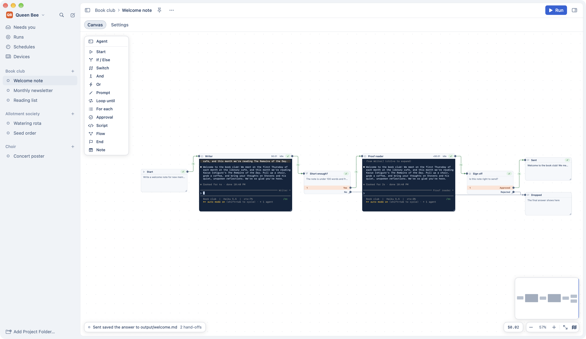
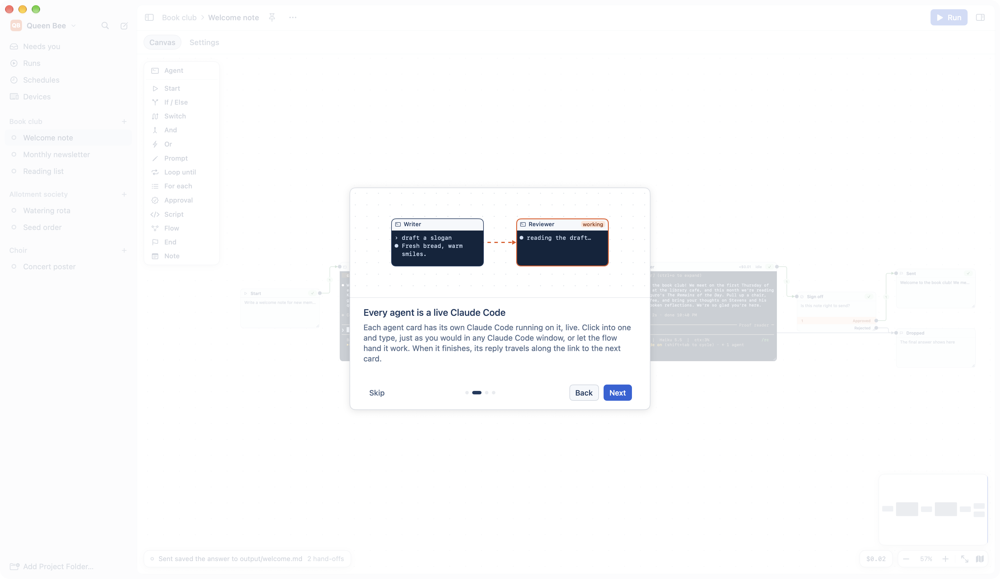
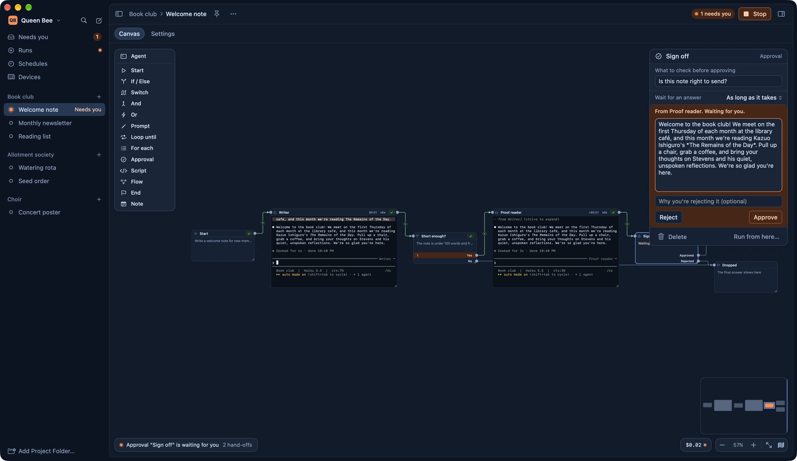

# Queen Bee

A Mac app for building and running flows of Claude Code agents on a canvas. It needs macOS 26 or later on Apple silicon.

Queen Bee is a work in progress. It is open source, and [contributions are welcome](CONTRIBUTING.md).

Each agent is a live `claude` session in a terminal that sits on the canvas. You can click into any of them and type. Logic cards (If / Else, Switch, And, Or, Prompt, Loop until, Approval, Script, Flow, End) route each agent's finished reply to the next cards. Every flow also has an orchestrator, a Claude Code session docked beside the canvas that can edit the flow, run it and talk to the agents.



The app follows light and dark. [The same run in dark](docs/queen-bee-flight-plan-dark.png).

## Install

**From a terminal** (opens straight away):

```sh
curl -fsSL https://raw.githubusercontent.com/bamboozledkitty/queen-bee/main/scripts/install.sh | sh
```

This downloads the latest release, checks it is signed by the Queen Bee developer's certificate and puts it in Applications. You can [read the script](scripts/install.sh) first.

**From the disk image:**

1. Download `QueenBee-<version>.dmg` from the [latest release](https://github.com/bamboozledkitty/queen-bee/releases/latest).
2. Open it and drag **QueenBee** onto the Applications folder beside it.
3. Open Queen Bee from Applications. macOS will say it could not verify the app; the steps below get past that.

You need:

- macOS 26 or later on Apple silicon.
- [Claude Code](https://claude.com/claude-code) 2.1.287 or later, signed in. The app loads a small plugin into each session, which needs that version.

Releases are signed with a Developer ID but not yet notarized by Apple. A copy downloaded in a browser is blocked the first time you open it, with a message that Apple could not verify it. The terminal install doesn't hit this. To open a blocked copy:

1. Click **Done** on that message.
2. Open **System Settings → Privacy & Security** and scroll to the Security section.
3. Click **Open Anyway** beside the line about Queen Bee, then confirm.

You only do this once. The app checks for updates by itself, and **Queen Bee → Check for Updates…** checks straight away. What changed in each version is in [CHANGELOG.md](CHANGELOG.md).

Queen Bee starts Claude Code sessions as you and is not sandboxed. Read [SECURITY.md](SECURITY.md) before opening flows from someone else.

Flows are saved in `<project>/.queenbee/flows/`, and agents work in the project folder.

## Build from source

You need Xcode 27 and [xcodegen](https://github.com/yonaskolb/XcodeGen) (`brew install xcodegen`).

```sh
./scripts/build.sh
open build/Build/Products/Debug/QueenBee.app
```

A build from source is called Queen Bee Dev. It keeps its own settings and support folder, so it can run beside an installed copy without touching it.

## Use

- **Add Project Folder…** at the foot of the sidebar adds a folder. Each folder lists its flows, and **+** beside its name makes a new one.
- The first time you open the app, a short walk-through explains agents, logic cards and the orchestrator. **Help → Welcome to Queen Bee** shows it again.

  

- An empty flow shows a note pointing at the orchestrator: describe the flow you want there and it builds it. Close the note to build by hand.
- The **palette** at the canvas's top-left holds the card types. Click one to add it, or drag it to where you want it. Rest the pointer on one to read what it does. Each agent card starts its own Claude Code session.
- An **Approval** card stops a run until you approve, edit or reject the message. A **Script** card runs a shell command and goes out Pass or Fail; a command you didn't type yourself asks before it first runs. A **Flow** card runs another flow as one step: double-click it to open that flow, or to make a new sub-flow with an Input and an Output, and use the names in the title bar to go back. Sub-flows can hold Flow cards of their own, three levels deep unless you change the limit in the top flow's settings (the sliders button in the toolbar).

  

- An Approval card can be told to wait at most so long, then approve or reject the message itself. A Script card can be told how long to wait for you to allow a command before skipping it.
- A **For each** card splits a list into items, one per line or the items of a JSON list, and sends them out Each one at a time. Link the last card that works on an item back into the For each card: what comes back that way is that item's result. When every item is back, all the results go out Done together. A **Loop until** card that runs out of tries goes out Gave up, or Done if nothing is linked to Gave up.
- In a git repository, each flow works on one branch. The first time a flow opens, Queen Bee asks where: **This folder**, on its branch or switched to another, or **A worktree**, a separate copy on a branch of its own made from main or a branch you pick. The chip after the project's name in the title bar shows the branch and opens the same choice later. Worktrees are kept in the project's `.queenbee/worktrees` folder, and a sub-flow works wherever the flow at the top does. Switching the folder to another branch waits while it has uncommitted changes or another flow is running in it.
- A flow's settings (the sliders button in the toolbar) can stop a run once it has spent a set amount, reckoned at API prices from what its agents have used.
- Turn on **Browser** in an agent's settings to give it a web browser in its card: terminal on the left, the live page on the right. The agent opens and reads pages by itself and asks before it clicks or types, unless its permissions say otherwise. Click into the page to use it yourself, for instance to sign in to a site; agents with a browser in the same project share those sign-ins, and **Clear browser data** in the flow's settings forgets them. It uses Chrome, Chromium, Edge or Brave if one is installed, and offers to download a browser of its own if not.
- A Start card's settings can make it run on a schedule or when a file changes. Schedules run only while Queen Bee is open.
- **Run from here…** in a card's settings starts a run at that card with a message you give it. A card a run stopped at offers **Retry**.
- An agent's settings can be saved as a **role**, which then sits under Agent in the palette for any flow.
- Select several cards and choose **Group** (⌘G) to frame them under a name. Double-click the name to fold the group into one card. **Tidy Up** (⇧⌘L) lays the whole flow out left to right. **Find** (⌘F) goes to a card or flow by name. A map in the corner shows the whole flow once it has five cards or more.
- Drag a card by its title bar. Drag its bottom-right corner to resize it. A dragged card lines up with its neighbours or settles on the grid; hold Option to place it freely. Pinch to zoom and two-finger scroll to pan, or use the zoom control at the bottom-right. With a mouse: the wheel pans up and down, Shift with the wheel pans sideways, Command (or Control) with the wheel zooms about the pointer, and holding Space or the middle button turns the pointer into a hand that drags the canvas.
- Shift-click cards, or drag a box on empty canvas, to select several. They move, duplicate (⌘D), copy, paste and delete together, and the arrow keys nudge them. Escape deselects.
- ⌘Z undoes the last change to the flow, including changes the orchestrator made. With the cursor in a text box, it undoes typing there first.
- Right-click a card, a link or empty canvas for a menu.
- Zoomed out below 40%, each card shows its name and state in large type in place of its contents.
- Drag from a dot on a card's right edge onto another card to link them. Click a link to change its max passes or delete it.
- Click a card's title to open its settings: rename it in the header, change its rows, and delete or restart it from the footer. Click inside a terminal to type in it; click empty canvas to give the keyboard back.
- Write the Start card's command, then press **Run**. Cards the run passes through get a check and a count, travelled links turn green, and the link a message is on now shows orange dashes.
- The panel on the right has the **Orchestrator**, the run **Log**, and the **Output** of each End card. The line at the canvas's bottom-left shows the latest step. Every run is kept between launches, and the Log tab's menu puts an earlier run back on the canvas.
- Click a link to read the messages it carried in the run on show.
- The figure beside the zoom control is what the flow has used, at API prices, as Claude Code reports it. Click it for a breakdown by agent and by run.
- When the app is in the background, a notification tells you that a card needs you or a run has ended. **Settings** turns this off.
- A flow that needs you says so on its sidebar row, and the toolbar shows a button that takes you to the waiting card.
- **View → Appearance** switches between light, dark and following the system.
- **Remote.** An iPad or iPhone on the same Wi-Fi can watch your flows, and run, answer and edit them if you let it. **Settings → Remote** turns it on and pairs a device. See [On your iPad or iPhone](#on-your-ipad-or-iphone).

### Start a flow from outside the app

The app ships a small command, `qb`, inside it. With Queen Bee open, it starts a flow from Terminal or a script:

```sh
alias qb="/Applications/Queen Bee.app/Contents/MacOS/qb"
qb run ~/work/site "Review" "Check the homepage for broken links"
```

It names the project folder, the flow by its name or id, and the message the run starts with, as if you had typed it into the Start card (leave it out to use the card's own). It waits for the run to end, prints what reached the End cards and exits 0. A run that ends with no answer prints how it ended and exits 1; a run that couldn't start, because the app isn't open, the flow isn't found or is already running, exits 3. `--no-wait` returns as soon as the run has started. The folder must be one you have added to Queen Bee and trusted.

A link starts a flow too: `queenbee://run?flow=<flow id>&message=<message>`, with the message URL-encoded. Any web page or app can open such a link, so Queen Bee shows you the flow and the message and starts the run only if you press **Run**.

## On your iPad or iPhone

There is a companion app for iPad and iPhone. It pairs with Queen Bee on your Mac over your local Wi-Fi, with no server and no account, and shows what the Mac is doing.

It shows:

- every project and its flows, with the same "needs you", "running" and "stopped" badges as the Mac's sidebar;
- the open flow's canvas as the Mac draws it, live: cards, links, groups, run marks and counts;
- each agent's terminal in its card, and full screen, where you can scroll back through earlier output;
- the run log, the answers the End cards collected, earlier runs, and what the flow has cost, with its sub-flows;
- which cards are waiting on you;
- pinned flows first, sub-flows under the flow that runs them, and **Find** across every flow and card.

On an iPad the panel beside the canvas has three tabs: **Orchestrator**, **Run** (the log and the answers) and
**History** (earlier runs and cost). Tap a card, a link or a group and its details slide in over the panel, with a
way back to the tab you were on; tap empty canvas and they go. On an iPhone a card's details come up in a sheet over
the canvas, and the button in the bar at the top brings up the panel's three tabs in a sheet of their own.

A device you have just paired only watches. Turn on **Can control** for it on the Mac, as described below, and from the device you can also:

- run a flow from its Start card and stop a run, with **Run** and **Stop** at the foot of the canvas;
- **Approve** or **Reject** a message an Approval card is holding, with a note saying why, and edit the message before approving it;
- let a Script card's command run with **Allow and run**, after reading it in full, or choose **Don't run**;
- start a flow's sessions with **Start its agents**, and start or restart one agent from its card;
- start a run part-way through, with **Run from here…** in a card's details;
- send a message to the orchestrator or to any agent, and press keys in its terminal;
- build and change a flow by touch, once you press **Edit**: see [Edit a flow](#edit-a-flow) below;
- nearly everything else the Mac's buttons do: **Run from This Start**, **Retry**, **Stop Its Agents**, start and
  restart the orchestrator and **Restart to apply**, **Undo** beside "Not in use yet", turn a schedule on and off,
  **Clear** the log, close the message at the top of a flow, pin a flow, and save, update and delete roles;
- see an agent card's browser beside its terminal, and use it full screen: tap, scroll and type in the page, type an
  address, go back and forward, reload, and copy and paste. Clear its data, restart it, or take up the Mac's offer
  to download one.

The buttons are on the cards themselves, in the "needs you" list at the top of the canvas, and in a card's details.
A few things stay on the Mac: allowing a Script command a device wrote, an agent's folder, project folders and
"trust this folder", Remote settings, the app's own settings and updates. A device that only watches sees no
page of any card's browser: the card says "Turn on “Can control” for this device to see the page."

### Let a device control your Mac

On the Mac, open Queen Bee's **Settings** and find **Remote**. Each paired device is listed there with a **Can control** switch. Turn it on for the device. It is off for every device until you do, and off again for a device you pair a second time. Turning it off takes effect at once.

Under the list the Mac says what the switch allows: "A device with “Can control” on can start and stop runs, answer approvals, type into sessions and edit flows on this Mac." Typing into a session includes answering Claude Code when it asks whether it may run a command, so give this only to a device you would hand your Mac's keyboard to. The same goes for an agent's browser: what a device does there is your own input, on whatever site the card is signed in to. [SECURITY.md](SECURITY.md) has the whole list of what it allows and what it never does. Everything done from a device is written in the flow's log on the Mac with the device's name.

### Talk to the orchestrator or an agent

Open the session's terminal full screen: tap the arrows on an agent's card, or tap the arrows on the **Orchestrator** tab of the panel beside the canvas. On an iPhone the panel comes up from its button in the bar at the top. Under the terminal there are two ways to type.

- **Message** is a box and a **Send** button. Write what you want to say and send it. The Mac delivers it when the session is ready for a message, so you can send one while it is busy. This is the way to chat with the orchestrator. The panel's **Orchestrator** tab has a message box of its own, so you can write to it without opening its terminal.
- **Keys** brings up the keyboard with a row of extra keys above it: Esc, Tab, Ctrl, the arrows, Enter and the digits and letters Claude Code's prompts ask for. Each key goes to the session as you press it. Use it to answer a prompt in the terminal, such as "Allow this command? 1. Yes 2. No", or to interrupt with Esc. When an agent is waiting for an answer like that, its line in the "needs you" list has **Open its terminal**, which opens it with the keys out.

### Edit a flow

Editing is a mode you turn on, so a stray finger never moves a card while you are only watching. Press **Edit** at the foot of the canvas, or at the foot of a card's details on an iPhone. A bar appears with **Undo**, **Redo**, **Add Card**, **Select**, **Tidy Up** and **Done**. While it is on:

- drag a card by its title bar to move it, with the same snapping and guides as on the Mac, and drag the grip at its corner to resize it;
- drag from a port dot to another card to link them;
- copy, cut and paste cards, across flows too, and select all;
- touch and hold a card, a link or a group for its menu: duplicate, delete, group, ungroup, fold, rename, run from here. Touch and hold empty canvas to add a card there;
- press **Select**, then drag a box round cards or tap them, to move, group or delete several at once;
- open a card's details to change its settings: the same fields as the Mac's settings panel, with the same names and choices. A link's limit and a group's name are there too. The flow's own settings are in the **…** menu beside the run bar, and in the flow's menu in the list;
- in the list of flows, **+** beside a project makes a flow in it, and touching and holding a flow renames or deletes it.

Undo and Redo are the Mac's own, shared with whoever is at the Mac: either of you can undo what the other did. Deleting several cards, or a card with links, asks first. Deleting one link or one unlinked card does not, because Undo brings it back. Deleting a flow always asks, by the flow's name, and the flow goes to the Trash on your Mac.

The Mac did not see you make these changes, so it treats them more carefully than its own:

- A Script card's command you change from a device stops the run and waits to be allowed **on the Mac**. No device can allow it. The device says so where its **Allow and run** button would be.
- Any change to what a flow does turns that flow's schedules off, and those of any flow that runs it as a sub-flow. Moving and resizing cards, grouping them and writing notes don't count. A schedule set from a device arrives switched off, and **Turn on** in the Start card's details turns it on, which the Mac's log notes each time.
- A role saved or changed from a device is marked on the Mac, which asks before you first use it there and keeps what the role held before. A role deleted from a device can be restored on the Mac for 30 days.
- An agent's folder is shown and is changed on the Mac. A permission mode that skips permission checks can't be set.
- An agent card you add from a device does not start by itself in a flow that is open on the Mac: press **Start agent** on it. A flow can be given twelve agents from a device.
- What you write in a setting is sent when you leave the field or pause. If the Mac can't be reached or turns it down, what you wrote stays in the field, marked as not saved, with the Mac's reason beside it.

[SECURITY.md](SECURITY.md) has all of the rules and what they do not stop.

### After you update the Mac app

The two apps must be on the same version. When you update Queen Bee on your Mac, build and install the iPad and iPhone app again from Xcode, from the same version of the source. Until you do, the device says which of the two needs updating and shows nothing else.

The app isn't on the App Store. You build it yourself and put it on your own device, which a free Apple ID is enough for. The device needs iOS or iPadOS 26 or later.

### Install it on your own device

You need Xcode 27 and xcodegen, as for building the Mac app.

1. Sign in to Xcode with your Apple ID: **Xcode → Settings… → Accounts**, then **+**. On the same pane choose **Manage Certificates…**, then **+**, then **Apple Development**.
2. Find your team id. It is ten letters and digits. In a terminal:

   ```sh
   security find-certificate -a -c "Apple Development" -p | awk '/BEGIN/{c=""} {c=c $0 "\n"} /END CERT/{cmd="openssl x509 -noout -checkend 0 -subject"; printf "%s", c | cmd; close(cmd)}' | grep -B1 "will not expire" | grep -o "OU *= *[A-Z0-9]*" | sort -u
   ```

   The team id is the part after `OU=`. The command looks only at certificates that are still good, because a Mac that has been signed in to Xcode before can hold expired ones from another account.
3. Make your own settings file and fill in its two lines:

   ```sh
   cp Mobile/Local.example.xcconfig Mobile/Local.xcconfig
   ```

   Open `Mobile/Local.xcconfig`, remove the two slashes at the start of the `DEVELOPMENT_TEAM` and `PRODUCT_BUNDLE_IDENTIFIER` lines, put your team id after the first `=`, and change `yourname` in the second to something nobody else would pick. Git ignores this file. Never commit it.
4. Generate the project and open it:

   ```sh
   xcodegen generate
   open QueenBee.xcodeproj
   ```

5. Plug in the iPad or iPhone. In Xcode's toolbar pick the **QueenBeeMobile** scheme and your device. It installs a
   Release build, which has none of the test harness in it. **QueenBeeMobile Debug** is the same app built for
   debugging from Xcode.
6. On the device, turn on **Settings → Privacy & Security → Developer Mode**, and restart it when asked. The switch only appears once the device has been connected to Xcode.
7. Press **Run** in Xcode.
8. The first time, the app won't open until you trust yourself as its developer: on the device, **Settings → General → VPN & Device Management**, tap your Apple ID, then **Trust**. Open Queen Bee again.

An app installed with a free Apple ID stops opening after 7 days. Press **Run** in Xcode again to install it afresh. It stays paired.

### Pair it with your Mac

Both need to be on the same Wi-Fi.

1. On the Mac, open Queen Bee's **Settings** and find **Remote**. Turn on **Let your iPad or iPhone connect**, then click **Pair a device…**. A code appears. It works once, for two minutes.
2. On the device, open Queen Bee and tap **Continue**. The first time, iOS asks whether Queen Bee may find devices on your local network. Allow it.
3. Choose your Mac from the list, then point the camera at the code.

From then on the device connects by itself whenever both apps are open on the same Wi-Fi. To stop a device connecting, click **Remove** beside it in the Mac's settings, or tap the gear on the device and choose **Forget this Mac**. [SECURITY.md](SECURITY.md) says what a paired device can see and what each side stores.

If the device can't connect, its pill says so and it keeps trying. When your Mac turns its key down several times
running, it says "Can't connect to your Mac — retrying" and offers **Pair Again…** beside that. A Mac going to
sleep or a Wi-Fi drop part-way through connecting never makes a device forget its key.

Switching to another app for a moment doesn't disconnect: the device stays connected for about 25 seconds after you
leave Queen Bee, then lets go until you come back.

### Connect from another network

Pairing needs the same Wi-Fi. After that, a device can also reach the Mac by its address, as over a private network
such as [Tailscale](https://tailscale.com).

1. On the Mac, in **Settings → Remote**, turn on **Let devices connect by address too**. The Mac shows the port it
   listens on, 51720, and the addresses it can be reached at.
2. On the device, tap the gear, and under **Connect by address** type one of those addresses, such as
   `mac.tail1234.ts.net` or `100.64.0.7`, then **Save**. Add `:port` only if the Mac shows a different port.

The device still looks for the Mac on the Wi-Fi first, and tries the address when it isn't found there. Each device
still needs its own key from pairing, and the connection is encrypted with it as on the Wi-Fi. Use an address only on
a network you trust: don't open the port to the internet.

### Notifications

While Queen Bee on the device is connected, and for the short while after you leave it, it can tell you when a
message is waiting for approval, a Script card is waiting to be allowed, a session asks you something, or a run
ends. On a device with **Can control**, an approval can be answered from the notification with **Approve** or
**Reject**, and a script with **Allow** or **Don't Allow**, once the device is unlocked. The app asks whether it may
notify you the first time it connects; the switch is under **Notifications** in its settings. Nothing comes from a
server, so once iOS stops the app in the background, nothing more arrives until you open it again.

### Run it in the Simulator

No Apple ID is needed for this.

```sh
./scripts/build-mobile.sh
xcrun simctl boot "iPad Pro 11-inch (M5)"
open -a Simulator
xcrun simctl install booted build/Build/Products/Debug-iphonesimulator/QueenBeeMobile.app
xcrun simctl launch booted dev.queenbee.mobile
```

Use the name of any iPad or iPhone simulator you have (`xcrun simctl list devices` lists them). The Simulator has no camera, so the app asks for the code as text: on the Mac click **Copy the code as text** under the code, then paste it into the app.

## How it works

- `Core/` is a Swift package with no UI: the flow model, the file store, the routing engine, the orchestrator's tools and the socket messages. `cd Core && swift test` runs its tests.
- `App/` is the SwiftUI and AppKit app. The canvas is an `NSScrollView` with magnification, and each terminal is a SwiftTerm view inside a card. `App/Design/Tokens.swift` holds every colour, type size, spacing step and timing the views use.
- `App/Browser/` runs a hidden Chromium for agent cards that have a browser, one per project, and controls it over a private pipe with the Chrome DevTools Protocol. Each card has a tab: the page is streamed into the card as pictures, and the agent's tools are served by `qb browser-mcp`.
- `Core/Sources/QueenBeeCore/Capabilities.swift` is the one place that says what each card and each agent can do. The app writes it into each project as `.queenbee/CAPABILITIES.md` for the orchestrator to read, its tools take their settings from it, and the build writes it out as [CAPABILITIES.md](CAPABILITIES.md). A capability added anywhere else doesn't build or fails the tests.
- `Helper/` builds `qb`, a small binary inside the app bundle. Claude Code hooks, the plugin and the orchestrator's tool server all run it, and it talks to the app over a unix socket in `~/Library/Application Support/QueenBee/`.
- `Mobile/` is the iPad and iPhone app. It links the same `Core/` package for the messages, the flow model and the link routes, draws the canvas with UIKit and the panels with SwiftUI, and feeds each terminal the output the Mac sends. `Mobile/Design/Tokens.swift` mirrors the Mac's tokens value for value.
- `Plugin/qb-link/` is the plugin the app loads into every session. When an agent's turn ends it asks the app where the reply goes and sends it there as a Claude Code session message.

## Tests

```sh
cd Core && swift test        # unit tests on the model, store, engine, link router, snapping, layout, triggers, tools, the Remote link, what a device may ask, the rules its edits are held to, the keys it sends, a card's browser on a device and the browser's tools
./scripts/e2e.py             # end-to-end: real Claude Code sessions on Haiku, about seven minutes
```

The end-to-end script starts a separate test copy of the app with its own support folder, so a copy you have open is left alone. It builds a scratch project with one flow per scenario and drives the app through a test harness that only exists when the app is launched with `--testing`. Name scenarios to run a few: `./scripts/e2e.py guard loop`. A scenario that can't run on this Mac, such as one whose app isn't built, is counted as skipped. The run fails when a scenario you named was skipped, or when nothing passed.

The iPad and iPhone app is checked in the iOS Simulator by ten scenarios that only run when named. Build it first with `./scripts/build-mobile.sh`.

```sh
./scripts/e2e.py terminals panels controls typing   # the app alone, with a Mac made up inside it: no Mac app, no Claude Code
./scripts/e2e.py editing settings-edit              # the same, for Edit: every gesture, every setting, and making, renaming and deleting flows
./scripts/e2e.py parity browser-canned              # the same, for the rest of the Mac's controls and a card's browser in each of its states
./scripts/e2e.py mobile                              # the app paired with the test copy of the Mac app, with real sessions
./scripts/e2e.py browser-mobile                      # a card's browser on the device, against the test copy and a small local site
```

`browser-remote` checks a card's browser from the stand-in device, with no Simulator: what a device is sent while it watches only and with control, the pace and size of the pictures and the bar, every way of using the page, and what a page can't make the Mac do.

`remote` checks the Mac's side of the link with a stand-in for the device, and needs no Simulator: what a device may ask, that all of it is refused until "Can control" is on, every edit against the flow file the Mac saves, the rules a device's edits are held to, and what the Mac's log says of it. `mirror` checks the copy of a terminal a device is sent.

`QB_E2E_SIMULATOR="iPhone 17"` picks the simulator, and `QB_E2E_SHOTS=<folder>` says where the screenshots go.

## Launch flags

- `--open <folder>` opens that project folder in the first window. Give it more than once to open several.
- `--float` keeps the window above others without taking focus. Terminals stop painting in a hidden window, so a check that looks at the window needs it.
- `--welcome` shows the first-run walk-through in a test copy, which otherwise skips it.
- `--testing` turns on the test harness and lets a second copy of the app run. `QB_SUPPORT_DIR` in the environment moves that copy's socket and plugin.

`--testing`, `--welcome` and `QB_SUPPORT_DIR` only work in a debug build.

## Releasing

For maintainers. Raise `MARKETING_VERSION` and `CURRENT_PROJECT_VERSION` in `project.yml`, put the same version in `Plugin/qb-link/.claude-plugin/plugin.json` and in `MCPServer.version` in `Core/Sources/QueenBeeCore/MCP.swift`, add a section for the version to `CHANGELOG.md`, commit, then:

```sh
./scripts/release.sh check      # the checks alone: the version matches everywhere, the build number is above appcast.xml's, the tree is clean
./scripts/release.sh            # build, sign, notarize and write the feed, into dist/
./scripts/release.sh publish    # the same, then release it on GitHub, tag it and push appcast.xml
```

`swift test` fails too when the three versions disagree. Publish puts the disk image on GitHub before it pushes `appcast.xml`, so installed copies are never pointed at a download that isn't there, and running it again after a failure carries on from the step that failed. Releases from a `release/<version>` branch reach installed copies once that branch is merged into `main`, where they read the feed.

The releases so far are signed but not notarized: they were made with `QB_SKIP_NOTARIZE=1`. The script notarizes when the notarization profile is set up. Its header lists the certificate, profile and update key it needs.

## Contributing

[CONTRIBUTING.md](CONTRIBUTING.md) covers building, testing and the list of known issues where help is wanted.

## License

[MIT](LICENSE). The licenses of the packages the app is built with are in [THIRD-PARTY-NOTICES.md](THIRD-PARTY-NOTICES.md), and a copy ships inside the app.
